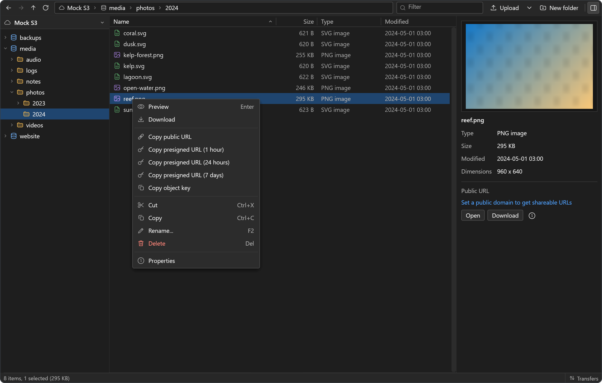

<div align="center">
	<br>
	<br>
	
	<br>
	<br>
	<h1>Fathom</h1>
	<b>High performance Cloudflare R2 storage manager</b>
	<br>
	<br>
	<p>
		<a href="https://github.com/dend/fathom/actions/workflows/ci.yml"></a>
		<a href="https://github.com/dend/fathom/actions/workflows/release.yml"></a>
		<a href="https://github.com/dend/fathom/releases/latest"></a>
		
		<a href="LICENSE"></a>
	</p>
	<br>
</div>



- Browse buckets and folders, even ones with tens of thousands of files.
- Upload and download in bulk, or drag files onto the window.
- Rename, delete, copy and move files across folders and buckets.
- Preview images and text, and edit text files in place.
- Copy a file's public URL on your custom domain, or a presigned URL.

## Install

1. Download the installer for your platform from the [latest release](https://github.com/dend/fathom/releases/latest).
2. Run it. On macOS, then run `xattr -dr com.apple.quarantine /Applications/Fathom.app`.
3. To update later, run the newer installer.

## Connect to R2

1. Create an API token in the [Cloudflare dashboard](https://dash.cloudflare.com/?to=/:account/r2/api-tokens), under **R2 > Manage API tokens**.
2. In Fathom, choose **Add connection...** and paste your **Account ID** and the token's **Token value**.

## Build

```sh
cargo run
```

On Linux, install `libdbus-1-dev` and `pkg-config` first.

## License

[MIT](LICENSE)
